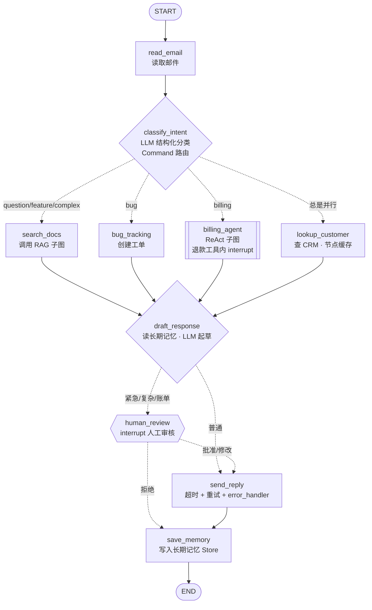

# 智能客服工单 Agent —— 用一个项目串起 LangGraph 官方文档

这个项目根据 [LangGraph 官方 Python 文档](https://docs.langchain.com/oss/python/langgraph/overview)（langgraph 1.2.x）编写。
骨架来自文档里的 **《Thinking in LangGraph》客服邮件 Agent**，并把文档其余章节的知识点
（持久化、记忆、人工审核、子图、流式、容错、缓存、时间旅行、测试、部署）都放进同一个能跑的项目里。

- **主项目 `support_agent/`**：一个完整的业务 Agent，展示这些知识点在真实项目里怎么组合使用；
- **示例 `examples/01~10`**：每个文件对应一组文档页面，几十行代码讲清一个概念，方便对照文档学；
- **离线可运行**：不配置 API key 时自动使用规则驱动的假模型，所有功能都能跑通；
- **国内可用**：配置 DeepSeek / 通义千问的 key 后就是真实 LLM。

---

## 1. 它做了什么

客户发来一封邮件 → Agent 分类 → 按类别分头处理 → 起草回复 → 必要时人工审核 → 发送 → 记入客户历史。



| 场景 | 示例邮件 | 走的路径 |
|---|---|---|
| question | 我忘记密码了，怎么重置？ | RAG 检索 → 起草 → 直接发送 |
| bug | 导出 PDF 时崩溃了 | 创建 BUG 工单 → 起草 → 直接发送 |
| billing | 订单 ORD-1001 被扣了两次钱！ | ReAct 子图查订单 → **暂停：批准退款？** → 起草 → **暂停：审核回复** → 发送 |
| feature | 能不能加个暗黑主题？ | RAG 检索不到 → **改写问题再检索** → 起草 → 发送 |
| complex | API 间歇性返回 504 | RAG 检索 → 起草 → **暂停：审核回复** → 发送 |

---

## 2. 快速开始

> 需要 **Python ≥ 3.11**（3.10 的 asyncio 不会把运行时上下文传给子任务，`get_stream_writer()` 等会报错；`langgraph dev` 也要求 3.11+）。
> 你的电脑上 `/opt/homebrew/bin/python3.13` 可以直接用。

```bash
cd customer-support-agent
/opt/homebrew/bin/python3.13 -m venv .venv
source .venv/bin/activate
pip install -r requirements.txt
cp .env.example .env        # 先不填 key，用离线假模型
```

**① 跑起来看效果（离线）**

```bash
python main.py run --auto-approve
```

**② 自己当审核员**：遇到暂停时在终端里输入 y / e / n

```bash
python main.py run -s billing
```

**③ 体验持久化执行**：审核时按 `Ctrl+C` 退出，然后用打印出来的 thread_id 继续（状态存在 `data/checkpoints.sqlite`）

```bash
python main.py resume billing-xxxxxxxx
```

**④ 体验容错**：`flaky` 第一次发送失败后重试成功；`down` 一直失败，由 error_handler 兜底

```bash
python main.py run -s question --email-mode flaky
```

```bash
python main.py run -s question --email-mode down
```

**⑤ 查看 checkpoint 历史 / 长期记忆**

```bash
python main.py history <thread_id>
```

```bash
python main.py memory zhang@example.com
```

**⑥ 跑测试**

```bash
python -m pytest -q
```

**⑦ 本地 Agent Server + Studio 可视化调试**（文档：Run a local server / LangSmith Studio）

```bash
langgraph dev
```

启动后浏览器打开终端里打印的 Studio 链接，能看到整张图、逐步执行、在 interrupt 处填写审核表单
（`ReviewDecision` 的 `response_schema` 会被渲染成表单）。也可以直接调 HTTP API：

```bash
curl -s -X POST localhost:2024/runs/wait -H 'content-type: application/json' -d '{"assistant_id":"customer_support","input":{"email_id":"api-1","sender_email":"li@example.com","email_content":"导出 PDF 的时候崩溃了"}}'
```

**⑧ 换成真实 LLM**：在 `.env` 里填 `LLM_API_KEY`（DeepSeek 或通义千问），其余命令不变。

---

## 3. 目录结构

```
customer-support-agent/
├── support_agent/                 # 主项目（文档 Application structure 推荐的结构）
│   ├── graph.py                   # ⭐ 第一个读：把节点连成图、配置容错/缓存/子图
│   ├── state.py                   # ⭐ State 设计：输入/输出 schema、reducer、结构化输出 schema
│   ├── nodes.py                   # ⭐ 所有节点：Command 路由、interrupt、Store、error_handler
│   ├── subgraphs/
│   │   ├── rag.py                 # Agentic RAG 子图（检索→评估→改写→再检索）
│   │   └── billing_agent.py       # ReAct 工具调用子图（ToolNode、tools_condition、RemainingSteps）
│   ├── tools.py                   # 工具定义；退款工具内部用 interrupt 等审批
│   ├── streaming.py               # 自定义 StreamTransformer → stream.extensions["progress"]
│   ├── config.py                  # 模型工厂 + Runtime Context（context_schema）
│   ├── prompts.py                 # 提示词模板（State 存原始数据，节点里再格式化）
│   ├── services.py                # 模拟的外部系统（知识库/CRM/订单/邮件），不用细读
│   └── mock_llm.py                # 离线假模型，不用读
├── examples/                      # 每个文件对应一组文档，独立可运行
├── tests/                         # pytest：节点单测、子图单测、整图集成测试、局部执行
├── main.py                        # 命令行入口：流式输出 + 终端里做人工审核
├── langgraph.json                 # langgraph dev / 部署用的配置
├── requirements.txt
└── .env.example
```

---

## 4. 推荐学习路线

**第一遍：先把项目跑起来，建立整体印象（约 1 小时）**

1. 跑 `python main.py run --auto-approve`，对照上面的流程图看输出；
2. 读 `support_agent/graph.py`：只看“有哪些节点、怎么连的”；
3. 读 `support_agent/state.py`：State 里有哪些字段、为什么 `audit_log` 需要 reducer；
4. 读 `support_agent/nodes.py`：从 `classify_intent` 开始，看节点怎么用 `Command` 决定下一步；
5. 跑 `python main.py run -s billing`，自己当审核员，体会 interrupt 是怎么暂停和恢复的。

**第二遍：按下表逐个概念学习 —— 先跑 example，再读文档，最后回到主项目找对应代码。**

| # | 示例 | 对应文档 | 在主项目里的位置 |
|---|---|---|---|
| 01 | `examples/01_graph_api_basics.py` | Overview、Graph API overview、Use the graph API | `state.py` 的 reducer / input·output schema；`graph.py` 的 `StateGraph` |
| 02 | `examples/02_workflows_and_agents.py` | Workflows and agents、Quickstart | `classify_intent` 的 `Command` 路由与并行；`billing_agent.py` 的 ReAct 循环 |
| 03 | `examples/03_persistence_time_travel.py` | Persistence、Checkpointers、Use time-travel | `main.py` 的 SQLite checkpointer、`history` / `resume` 命令 |
| 04 | `examples/04_long_term_memory.py` | Stores、Memory、Runtime context | `draft_response` 读记忆、`save_memory` 写记忆；`config.Context` |
| 05 | `examples/05_interrupts.py` | Interrupts | `human_review`（含 `response_schema`）、`tools.issue_refund`（工具内中断） |
| 06 | `examples/06_subgraphs.py` | Subgraphs | `billing_agent` 作为节点；`search_docs` 在节点内调用 `rag_graph` |
| 07 | `examples/07_streaming.py` | Streaming、Event streaming | `streaming.py` 的 Transformer；`main.py` 的 `run_until_pause` |
| 08 | `examples/08_fault_tolerance.py` | Fault tolerance、Thinking in LangGraph（错误处理） | `send_reply` 的 timeout/retry/error_handler；`set_node_defaults`；`lookup_customer` 的缓存 |
| 09 | `examples/09_functional_api.py` | Functional API、Choosing between Graph and Functional APIs | （主项目用 Graph API，这里对比另一种写法） |
| 10 | `examples/10_pregel_runtime.py` | LangGraph runtime (Pregel) | 解释主项目里“并行节点为什么要 reducer” |
| — | `tests/` | Test | 节点单测、`update_state(as_node=...)` 局部执行 |
| — | `langgraph.json` | Application structure、Run a local server、Studio、Deployment | `langgraph dev` |
| — | `state.py` 的 `NotRequired` | Backward compatibility | 新字段用 `NotRequired`，老 checkpoint 还能加载 |

**第三遍：动手改（最能检验是否真懂）**

- 给 `feature` 类邮件加一个“记录到需求池”的节点，和 `search_docs` 并行执行；
- 把 `ReviewDecision` 加一个 `priority` 字段，并在 Studio 里看表单变化；
- 把 `billing_agent` 改成 `compile(checkpointer=True)`，观察同一个 thread 里第二次调用时子图是否“记得”上次的对话；
- 用 `get_state_history` 找到 `draft_response` 之前的 checkpoint，`update_state` 改掉 `search_results` 后分叉重跑；
- 接入真实 LLM 后打开 LangSmith 追踪，观察每个节点的输入输出和耗时。

---

## 5. 核心概念速查（也是常见面试题）

<details>
<summary><b>LangGraph 和 LangChain 是什么关系？什么时候用 LangGraph？</b></summary>

LangChain 提供模型、工具等组件和高层的 `create_agent`；LangGraph 是底层的**编排框架和运行时**，
负责持久化执行、流式、人工介入、记忆。`create_agent` 本身就跑在 LangGraph 上。
需要把**确定性的业务步骤**和**LLM 自主决策**混在一个流程里、需要精细控制每一步时，用 LangGraph。
</details>

<details>
<summary><b>State、Node、Edge 分别是什么？Reducer 解决什么问题？</b></summary>

State 是所有节点共享的数据（TypedDict / Pydantic / dataclass）；Node 是“读 State、返回更新”的函数；
Edge 决定下一个执行谁（普通边、条件边、`Command(goto=...)`、`Send`）。
节点返回的 dict 默认**覆盖**对应字段；字段配了 reducer（如 `operator.add`、`add_messages`）就按 reducer **合并**。
同一个 super-step 里多个并行节点写同一字段时，必须有 reducer，否则报 `InvalidUpdateError`（见 `state.py` 的 `audit_log`）。
</details>

<details>
<summary><b>条件边和 Command 怎么选？</b></summary>

条件边的路由函数只决定“去哪”，不改 State；`Command` 让节点**同时**更新 State 和决定去向，
适合“分类结果 + 路由”这种一体的逻辑（`classify_intent`）。`Command(goto=[a, b])` 还能并行跳转。
`Send` 用于运行时才知道要开几个并行分支的 map-reduce 场景。
</details>

<details>
<summary><b>checkpointer 和 store 有什么区别？</b></summary>

checkpointer 按 `thread_id` 在每个 super-step 结束时保存整张图的 State，提供**短期记忆**、
interrupt、故障恢复、时间旅行；store 按 namespace 存任意 JSON 文档，**跨线程共享**，用于长期记忆
（本项目按客户邮箱存历史工单）。生产环境分别用 Postgres/SQLite/Redis 等实现。
</details>

<details>
<summary><b>interrupt 的原理和注意事项？</b></summary>

`interrupt(payload)` 抛出特殊异常，运行时保存 checkpoint 后把 payload 返回给调用方；
调用方用 `Command(resume=值)` 恢复时，**整个节点从头重新执行**，这次 `interrupt()` 直接返回该值。
所以：必须有 checkpointer；interrupt 之前的副作用要幂等；不要用裸 `try/except` 包住它；
多个 interrupt 按调用顺序匹配。`response_schema` 可以校验恢复值并让前端渲染表单。
</details>

<details>
<summary><b>LangGraph 如何处理错误？</b></summary>

按错误类型分：瞬时错误用 `RetryPolicy`；LLM 能修的错误写回 State 让它重来；需要人补充的信息用 `interrupt`；
重试耗尽但能补偿的用 `error_handler`（Saga 模式）；未知错误直接抛出。
`timeout=` 限制单次尝试时长（仅 async 节点），超时抛 `NodeTimeoutError` 并交给重试策略；
`set_node_defaults` 统一配置；`RunControl.request_drain()` 实现优雅停机。
</details>

<details>
<summary><b>什么是 super-step？为什么节点失败后会“从头重跑”？</b></summary>

LangGraph 底层是 Pregel/BSP 模型：每一步先规划要执行的节点，再并行执行，最后统一把写入合并进 channel。
checkpoint 只在步与步之间保存，所以恢复时从**节点开头**重新执行。
节点拆得越细，失败时重复的工作越少，也越容易观察和单独配置重试（见文档 Node granularity trade-offs）。
</details>

<details>
<summary><b>子图有几种接法？子图的持久化怎么配置？</b></summary>

两种：父子图有共享字段时，把编译好的子图直接 `add_node`；State 完全不同时，在节点函数里 `subgraph.invoke()` 并自己转换输入输出。
持久化：`compile(checkpointer=None)` 默认按调用持久化（支持 interrupt、不跨调用记忆）；
`True` 按线程累积状态；`False` 无状态。
</details>

<details>
<summary><b>如何测试 LangGraph 应用？</b></summary>

每个测试重新编译图并使用新的 `InMemorySaver`；`graph.nodes["名字"].invoke()` 单测节点；
子图单独 invoke；用 `update_state(..., as_node="上游节点")` + `interrupt_after=[...]` 只测试图的一段；
LLM 用确定性的假模型（本项目的 `MockChatModel`）避免结果不稳定。
</details>

<details>
<summary><b>上线后修改图结构要注意什么？</b></summary>

（文档 Backward compatibility）还有线程停在某个节点时，不要直接重命名/删除该节点；
新增 State 字段用 `NotRequired`；删除字段先保留一个周期；重命名用“先加新、再删旧”。
边的拓扑不存进 checkpoint，增删边对进行中的线程是安全的。
</details>

---

## 6. 文档覆盖说明

已覆盖：Overview、Install、Quickstart、Thinking in LangGraph、Workflows and agents、Persistence、Checkpointers、Stores、
Fault tolerance、Event streaming、Streaming、Interrupts、Use time-travel、Memory、Subgraphs、Application structure、Test、
Backward compatibility、Run a local server、LangSmith Studio（通过 `langgraph dev`）、LangGraph runtime、
Choosing between Graph and Functional APIs、Graph API、Functional API、Build a custom RAG agent、What's new in v1。

未写成代码（偏前端或平台运维，建议直接读文档）：Agent Chat UI 与 Frontend 系列（React 前端）、Deployment（LangSmith 云部署）、
LangSmith Observability（只需在 `.env` 打开 `LANGSMITH_TRACING`）、Build a custom SQL agent（思路与本项目的 ReAct 子图相同）、
各类迁移指南、自定义 Checkpointer/Store 的实现细节。

> 注：`stream_events(version="v3")` 在 langgraph 1.2 中标记为实验特性，运行时会有 Beta 警告；
> 如果未来接口变化，可改用 `graph.astream(..., stream_mode=[...], version="v2")`（见 `examples/07_streaming.py`）。
